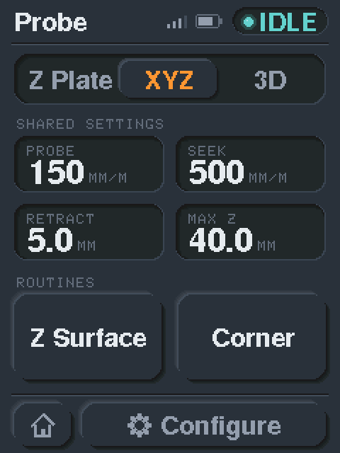
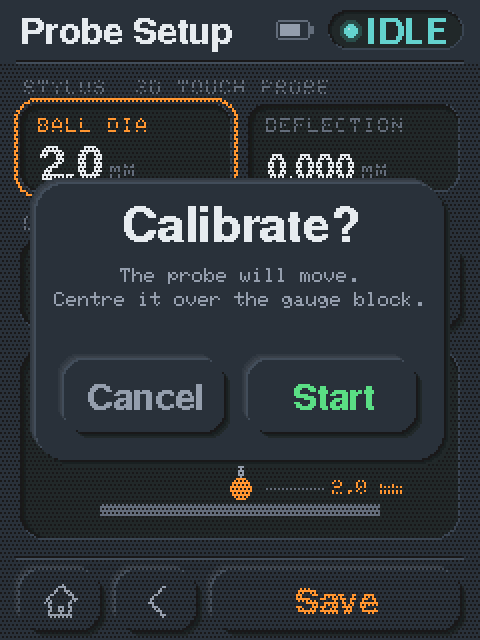
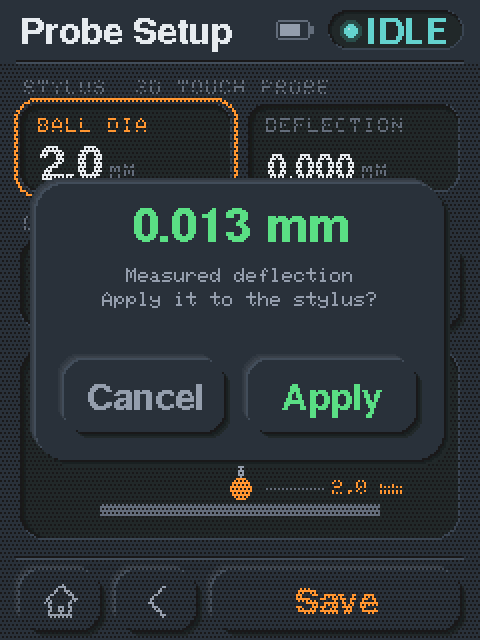
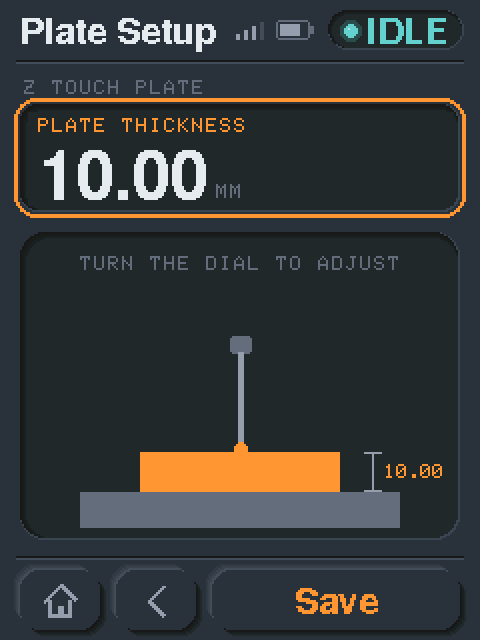
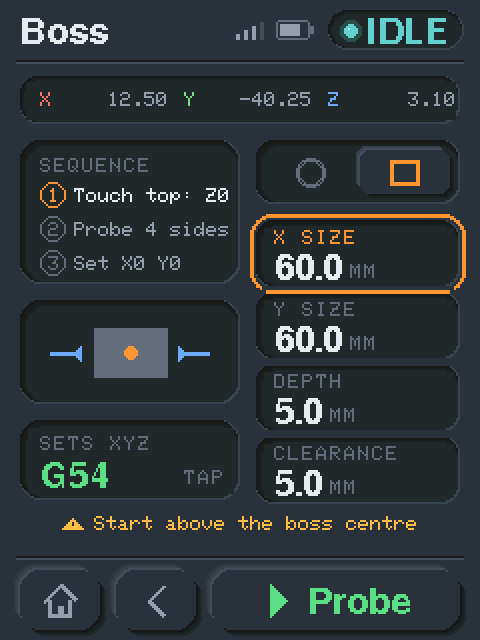

# FluidDial-CYD — Probing Guide

A per-screen reference for the probing workflow: what each screen shows, what every
option does, and how each routine actually moves the machine. The pictures are from
the neumorphic UI on the `neu-ui` branch.

Probing is reached from **Main Menu → Probe**. You land on the **Probe hub**,
pick a **probe type**, optionally open **Configure** to set up that probe, then
launch one of the **routines** (Z Surface, XYZ Corner, Bore, Boss). Each routine
generates its own G-code on the pendant and runs it on the controller — no probe
macro files need to live on the FluidNC SD card.

---

## Concepts to know first

These apply across all the routine screens.

**Probe types.** Three are supported, chosen on the hub:
- **Z Plate** — a Z-height touch plate: a conductive plate of known thickness laid on the work.
- **XYZ** — an XYZ touch plate: an L-shaped corner block that wraps a corner of the stock.
- **3D** — a spindle-mounted 3D touch probe with a ruby ball on a stylus.

The probe type gates which routines are offered (see the hub, below).

**Trigger compensation.** When a probe triggers, the machine position is the
*contact* point, not the workpiece surface/edge. The pendant offsets the zero it
writes so the WCS lands on the real surface:
- **3D probe** → offset = **ball radius + deflection** (`Ball dia ÷ 2 + Deflection`;
  deflection defaults to 0, so out of the box the offset is simply the ball radius).
- **Touch plate** → offset = **plate thickness**.

> The **XYZ-plate wall offsets** (Wall X / Wall Y) are also applied — they
> compensate the corner probe for the plate's wall thickness on each axis (see
> [Calibration](#calibration)). Plate **width** is saved for reference only and is
> not applied to the moves.

**Deceleration overshoot is removed.** `G38.2` records the exact position where the
probe input fired, but the machine keeps moving while it decelerates and comes to
rest slightly *past* that point (typically 0.2–0.3 mm, more at higher probe feed
rates) unless FluidNC's `hard_stop` is enabled. Zeroing where the machine stopped
would bake that overshoot straight into the work offset. Every routine therefore
returns to the true trigger point — `G53 G0` to the probe-result parameters
`#5061`/`#5062`/`#5063` — *before* it writes the zero. The corrective move is always
a retreat away from the work, and you do **not** need `hard_stop` for accurate zeros.

**Two-pass, crash-safe probing.** Every wall/surface is found with two moves:
a **fast seek** (at *Seek rate*) to make first contact, a small back-off, then a
**slow re-probe** (at *Probe rate*) for an accurate trigger. Crucially, *every*
approach toward material is a `G38.2` probing move that **stops on contact** —
there are no blind rapids into a wall, so a wrong "nominal diameter" can't crash
the tip (it just changes how far the seek travels).

**Every routine screen has the same layout:**

- **Position strip** (top) — the live work X / Y / Z.
- **Sequence** (left) — a numbered list of what the routine will do, in order.
- **Diagram** (left) — a small picture of the probe move, with arrows for the probe
  directions.
- **Settings** (right) — the routine's own fields. Tap one (it gets an orange ring),
  then turn the dial; tap it again to release. The dial speeds up to 10× after a
  few quick clicks in a row. Distances are stored in mm and shown in inches when
  the machine is in inch mode.
- **Result card** — what the routine sets and in which coordinate system, e.g.
  **SETS XYZ · G54** (see *Which WCS gets zeroed*, below).
- **Hint** (amber) — the setup reminder for that routine; it turns red with
  **Not connected** if you tap Probe without a controller.
- **Bottom bar** — **Home** · **Back** (to the Probe hub) · **Probe**.

 

**Confirm before it moves.**

Tapping **Probe** opens a **Start probing?** dialog naming the routine (and, for the
corner, which corner) and the coordinate system it will zero into. Nothing moves
until you tap **Probe** in the dialog; **Cancel** goes back. While the dialog is up
the dial does nothing, so the values can't change under you. When the routine
starts, the pendant switches to the **Status** screen so you can watch it.

 

**Which WCS gets zeroed.** The **result card** on every routine screen shows the
coordinate system the probe will zero, **G54–G57**. Tap the card to cycle through
them. Tapping is *selection only* — it doesn't switch the active WCS while you're
choosing (no surprise DRO jumps). When you actually **probe**, the routine
**activates** that system and writes the zero into it (`G54…G57` then
`G10 L20 P1…P4`), so the result is immediately live in the system shown on screen —
you don't need to re-zero by hand.

**Shared settings** (set once on the hub, used by every routine; always in mm, the
units the probe G-code runs in):

| Setting | Units | Meaning |
|---|---|---|
| **Probe** | mm/min | Feed for the slow, accurate *re-probe* pass. |
| **Seek** | mm/min | Feed for the initial fast *seek*. Default **500 mm/min**. |
| **Retract** | mm | How far the probe backs off / lifts after a touch. |
| **Max Z** | mm | Maximum distance a Z probe searches before giving up (a safety limit — the probe alarms if it finds nothing within this distance). |

---

## 1. Probe hub — the **Probe** screen

The entry point. Top to bottom:

- **Probe type** (segmented control): **Z Plate · XYZ · 3D**. Tap one to select it;
  the selected type is raised and orange. The routines on offer change to match.
- **Shared settings** — the 2×2 grid of *Probe · Seek · Retract · Max Z*. Tap a
  field to give it the dial (orange ring), turn the dial to adjust, and tap it again
  (or anywhere else) to release. Feeds step 10 mm/min, distances 0.1 mm. These values
  apply to every routine.
- **Routines** — the routines available for the selected type:
  - **Z Plate** → **Z Surface** only.
  - **XYZ** → **Z Surface**, **Corner**.
  - **3D** → **Z Surface**, **Corner**, **Bore**, **Boss**.
- **Bottom bar**: **Home** · **Configure**. *Configure* opens the setup screen for
  the currently selected probe type.

---

## 2. Configure screens

Opened with **Configure** on the hub. Which one appears depends on the selected
probe type. Tap a field to give it the dial, turn to adjust. **Save** stores the
settings and returns to the hub; **Back** returns without saving.

### 3D touch probe — the **Probe Setup** screen

| Field | Meaning |
|---|---|
| **Ball dia** | Diameter of the ruby ball. Its **radius** is the trigger offset applied to every routine — set it accurately. Steps 0.1 mm. |
| **Deflection** | Stylus flex measured at an edge. It is **added to the ball radius** in every edge offset the routines apply (Z surface, corner edges, boss top). Default **0** (off), may be negative; steps 0.001 mm. Measure it with **Calibrate** (see [Calibration](#calibration)). Centre-finding (Bore/Boss XY) is unaffected: it cancels across opposed faces. |
| **Gauge width** | Width of the reference block **Calibrate** measures against. Default 50.8 mm (the 2″ face of a 1-2-3 block). |

**Calibrate** asks **Calibrate?** before anything moves, shows **Calibrating…**
while it probes, then the measured deflection with **Apply** / **Cancel**. If a
probe misses or it times out, it shows **Calibration failed**.

### Touch plate — the **Plate Setup** screen

The **Z plate** gets one large **Plate thickness** field and a side view with the
thickness dimension. The **XYZ plate** gets four fields and a plan view of the
L-block on the stock corner:

| Field | Applies to | Meaning |
|---|---|---|
| **Thickness** | both plate types | Plate thickness — used as the Z trigger offset so Z0 lands on the work surface *under* the plate. |
| **Width** | XYZ plate only | Plate dimension. Recorded; not applied to moves. |
| **Wall X** | XYZ plate only | The plate's wall thickness on the X face. **Applied** to the corner probe so X0 lands on the workpiece edge, not the plate face. |
| **Wall Y** | XYZ plate only | The plate's wall thickness on the Y face. **Applied** to the corner probe so Y0 lands on the workpiece edge. |

All plate fields step 0.1 mm.

---

## 3. Z Surface

Zeroes **Z** on a flat surface (works with any probe type).

**Position before probing:** jog the probe/tool a little above the surface (or the
plate) you want to zero on. The hint reads *Plate clip connected?* (touch plate) or
*Probe connected?* (3D probe).

**Sequence:** ① *Fast seek -Z* → ② *Slow probe* → ③ *Set Z0*. The diagram shows the
probe above the work (and the plate, for a plate type) with a down arrow.

**Settings:**

| Field | Meaning |
|---|---|
| **Max travel** | How far down to search for the surface before giving up. The same value as **Max Z** on the hub. |
| **Retract** | How far to lift after setting Z0. The same value as **Retract** on the hub. |

Both step in whole mm here (or the inch equivalent).

**Result card:** *Sets Z0 in* G54–G57.

**How it works:** seeks down (fast) until contact, backs off, re-probes down
(slow), returns to the exact trigger point (`G53 G0 Z#5063`), then
`G10 L20 P# Z<offset>` sets Z0 with the ball-radius / plate-thickness offset
applied, and lifts by *Retract*.

 

---

## 4. XYZ Corner

Finds a workpiece **corner** and sets **X0, Y0 and Z0** there. (Always probes all
three axes.) Available for the XYZ plate and the 3D probe.

**Position before probing:** place the probe just **above and outside** the corner
you're zeroing, slightly off both edges. The hint reads *Probe above the corner*.

**Sequence:** ① *Touch top: Z0* → ② *Probe X & Y* → ③ *Set X0 Y0*. The diagram is a
top-down view of the stock with the chosen corner marked and the X/Y probe arrows;
it follows the corner picker.

**Settings:**

| Field | Meaning |
|---|---|
| **Corner picker** | A 2×2 grid laid out like the corners themselves — **TL TR / BL BR** (top-left, top-right, bottom-left, bottom-right, looking down with +Y up the screen). Tap the corner you're on; it sets the directions the probe approaches the two edges. |
| **Depth** | How far *below the top surface* to drop before probing the side edges, so the ball is beside the material when it reaches across. |
| **Overshoot** | Extra approach distance past the nominal edge, so the seek reliably reaches the wall. The probe first steps out by this amount, then seeks back in. |
| **XY retract** | How far to back off an edge after probing it. |

Depth, Overshoot and XY retract step 0.1 mm.

**Result card:** *Sets XYZ* in G54–G57. The confirmation names the corner, e.g.
*XYZ Corner, Bot-Left*.

**How it works:** probes the **top** to set Z0 (with offset), retracts, drops by
*Depth*, then probes the **X** edge (two-pass) and sets X0, and the **Y** edge
(two-pass) and sets Y0 — each with edge compensation (ball radius for the 3D probe,
or the plate's wall thickness for the XYZ plate) — then lifts. Each of the three
axes returns to its own trigger point (`#5063`/`#5061`/`#5062`) before being zeroed,
so no deceleration overshoot enters any of the three offsets.

 

---

## 5. Bore (3D probe only)

Finds the **centre of an inside circle / hole** and sets **X0/Y0** there. **No Z
motion at all** — set Z separately with the Z Surface routine. (The confirmation
reads *Bore centre (Z unchanged)* as a reminder.)

**Position before probing:** lower the probe tip **inside the bore**, roughly
centred, at any comfortable depth. The hint reads *Place the tip inside the bore*.

**Sequence:** ① *Probe 4 walls* → ② *Find centre* → ③ *Set X0 Y0*. The diagram is a
top-down view of the bore in the stock with outward arrows and the centre marked.

**Settings:**

| Field | Meaning |
|---|---|
| **Nominal dia** | Approximate bore diameter. Only a **travel hint** for how far the seek reaches toward a wall — because every move is a `G38.2` probe, this doesn't have to be exact and a wrong value won't crash the tip. |
| **Wall offset** | Extra seek over-travel margin added to the nominal radius, so the seek comfortably reaches the wall. |

Both step 0.1 mm.

**Result card:** *Sets X0 Y0 in* G54–G57.

**How it works:** probes **four points radially outward** at 90° (+X, +Y, −X, −Y),
each a two-pass move so contact is **perpendicular to the wall** (no tangential
skid). It probes the **±X pair first**, averages them to the centre X and
**re-centres in X**, then probes the **±Y pair through that centred X** so the Y
touches run through the true vertical diameter — accurate even from a well
off-centre start. The centre is the **midpoint of each opposed pair**; it moves
there and `G10 L20 P# X0 Y0`. Opposed pairs cancel the ball radius per axis (no
edge offset needed) and keep the maths division-free. The maths and the final move
are done in **machine coordinates** (FluidNC returns G38 results in machine
coords), so the result is correct under any work offset.

 

---

## 6. Boss (3D probe only)

Finds the **centre of a raised feature** and sets **X0, Y0 and Z0**. Handles both
a **round boss / round stock** and a **rectangular / square boss**.

**Position before probing:** start with the probe **above the centre of the boss**.
The hint reads *Start above the boss centre*.

**Sequence:** ① *Touch top: Z0* → ② *Probe 4 sides* → ③ *Set X0 Y0*. The diagram is a
top-down view of the boss — a circle or a rectangle, following the shape picker —
with inward arrows and the centre marked.

**Shape picker:** the two-segment control at the top of the settings, drawn as a
**circle** and a **square**. Tap one to switch between a **round** and a
**rectangular** boss; the fields change to match, and the choice is saved.

**Settings (round):**

| Field | Meaning |
|---|---|
| **Boss dia** | Approximate boss diameter — a travel hint for the inward seeks. |
| **Depth** | How far *below the boss top* to probe the side walls. |
| **Clearance** | How far *outside* the nominal radius to move before plunging down beside the boss. **Must exceed any under-estimate of the size** — this is the one number that has to be safe, because the downward plunge beside the boss can't be probe-protected. |

**Settings (rectangular):** the same, except *Boss dia* splits into **X size**
(feature width along X) and **Y size** (along Y); *Depth* and *Clearance* are
unchanged. Each axis's seek/clear distances are sized from its own half-dimension.

All fields step 0.1 mm.

**Result card:** *Sets XYZ* in G54–G57. The confirmation names the shape, *Round
boss* or *Rectangular boss*.

**How it works:** touches the **flat top** to set **Z0** (with offset). Then, for
each of **four directions** at 90° (+X, +Y, −X, −Y), it moves clear of the boss by
*Clearance*, plunges to *Depth* beside it, and two-pass probes **radially inward**
to the wall (perpendicular contact), lifting straight up between points. It does
the **±X pair first**, **re-centres in X**, then probes the **±Y pair through that
centred X**. The centre is the **midpoint of each opposed pair** — which is exact
for a circle *and* a rectangle — so it moves there and `G10 L20 P# X0 Y0`; Z0 from
the top is preserved. In rectangular mode the only difference is that the X pair
is sized from *X size* and the Y pair from *Y size*. The maths and final move use
**machine coordinates** (what FluidNC returns for G38), so the result is correct
under any work offset.

---

## 7. Work Area — manual work-zero

Reached from **Main Menu → Work**. This is the manual companion to the probe
routines — use it to pick the coordinate system and zero axes by hand (e.g. after
jogging to a known point), or to send the machine back to a zero.

- **G54 · G55 · G56 · G57** (segmented control) — tap to select the coordinate
  system. This is the same WCS the routines' result card selects, and selecting it
  here also makes it the machine's active system on the controller.
- **DRO** — live work and machine position.
- **Set zero here** — one button per axis (**X · Y · Z**, and A–C on machines that
  have them) plus **All**. Tapping a button zeroes that axis (or all axes) in the
  selected WCS at the current position (`G10 L20 P# …0`).
- **Go to zero** — **XY0** rapids to X0 Y0 (`G90 G0 X0 Y0`) and **Z0** lowers Z to
  the work zero (`G90 G0 Z0`), in the active coordinate system. Both move the
  machine, so each asks first, with a reminder to check Z is clear of clamps.
- Bottom bar: **Home** · **Jog**.

---

## Calibration

The config values that change *where a zero lands* are the **ball radius** and
**deflection** (3D probe), and the **plate thickness / wall offsets** (touch plate).
Get these right and every routine is accurate — plate width is reference-only.

> Centre-finding (**Bore**, **Boss**) is self-calibrating for radius *and*
> deflection: both cancel between the opposed pair on each axis, so their accuracy
> only matters for **Z Surface**, the **Corner** edges and the Boss top touch.

### 3D probe — effective tip offset (ball radius + deflection)

The offset an edge routine applies is **ball radius + deflection**. The stylus
flexes laterally before the probe triggers, so the reported edge position sits a
little *outside* the true face — **Deflection** adds that back. It defaults to **0**
(a plain ball radius) and may be **negative** for a probe that reads the other way.
Two ways to use it:

- **Simple (default):** leave **Deflection = 0** and calibrate **Ball dia** alone —
  the calibrated diameter absorbs the flex. Perfectly fine in practice.
- **Separated:** keep **Ball dia** at the nominal value and put the measured flex in
  **Deflection**. More transparent, and if you change stylus/feed you re-measure only
  the deflection.

#### Automatic calibration (on the pendant)

**Probe Setup → Calibrate** measures deflection for you against a gauge of known
width — most people use the **2″ face of a 1-2-3 block** (the default
**Gauge width** = 50.8 mm):

1. Set **Ball dia** first, and enter the **Gauge width** (default 2″).
2. Place the gauge on the table and jog the probe **roughly over its centre**, a few
   mm above the top.
3. Tap **Calibrate**, then **Start** in the **Calibrate?** dialog. The routine
   touches the top (to find a safe depth), then probes the **+X and −X faces** from
   outside — moving 10 mm past each assumed face before lowering 5 mm and probing,
   so it never plunges onto the part. It computes
   `deflection = ((x2 − x1) − gauge width − ball dia) / 2` and shows the result.
4. Tap **Apply** to store it (or **Cancel**). Calibration **never changes your work
   zero** — it only measures.

> The final edge accuracy still depends on a good **Ball dia** and a slow **Probe**
> rate. Because deflection is a lateral edge correction, **Bore/Boss centre-finding
> is unaffected** — it cancels across opposed faces.

#### Manual calibration (alternative)

1. Set **Ball dia** to nominal (Deflection 0). Run **XYZ Corner** against a known edge.
2. Measure where **X0** landed versus the true edge — call the single-edge error **Δ**.
3. Enter **Δ as Deflection** (or adjust Ball dia by 2 × Δ — pick one, not both).
4. Re-probe and confirm; keep the final pass slow.

### XYZ touch plate — plate offsets

The plate adds material between the tool and the true edge, so each offset is just a
physical thickness:

- **Thickness** (Z) — the plate's flat thickness. Measure it with calipers and enter it.
- **Wall X / Wall Y** — the thickness of each *vertical* wall of the L-block. Measure
  each wall with calipers and enter it, or calibrate exactly like the 3D probe above
  but adjust the offset by **1 × Δ** (the plate offset is applied directly, not halved).

---

## Quick reference — what each routine sets

| Routine | Probe types | Sets | Z motion |
|---|---|---|---|
| **Z Surface** | all | Z0 | probes down |
| **XYZ Corner** | XYZ plate, 3D | X0 Y0 Z0 | top touch + side edges |
| **Bore** | 3D | X0 Y0 | none — 4-point radial (Z via Z Surface) |
| **Boss** | 3D | X0 Y0 Z0 | top touch + 4-point radial |

Each routine **activates** the coordinate system shown on its result card
(G54–G57) and writes the zero there, so it's live immediately — no manual re-zero.
Everything uses two-pass crash-safe probing; the centre routines (Bore/Boss) probe
four points at 90° and take the midpoint of each opposed pair, computed in machine
coordinates.
