# FluidDial-CYD:
FluidDial-CYD is a custom firmware for CYD-equipped FluidDial CNC pendants. The UI has been rebuilt from the ground up for devices with 3 physical buttons and a jog dial. Supports both **resistive (XPT2046)** and **capacitive (CST816S)** CYD screen variants.

Runs **wired over UART** or **wireless over ESP-NOW** (requires FluidNC v4.0.4+), with **Li-Ion battery** support for a fully untethered pendant.

This branch (`neu-ui`) gives every screen a new **neumorphic** look: soft raised buttons and pressed-in readouts on a single slate surface, FreeSans type, and the machine state in a coloured chip at the top of every screen. Pictures and details are in [The neumorphic UI](#-the-neumorphic-ui) below.

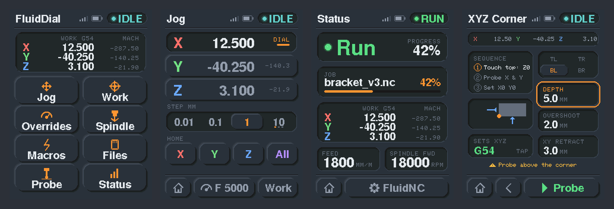

Feedback is welcome - If you find an issue or have a request for improvements, please log an [Issue](https://github.com/dJOS1475/FluidDial-CYD/issues) and I'll investigate.

**Updates:**
See [CHANGELOG.md](CHANGELOG.md)


**Web Installer** (use Chrome/Edge):
https://djos1475.github.io/FluidDial-CYD/

> The web installer and the [Releases page](https://github.com/dJOS1475/FluidDial-CYD/releases) install the current release, which uses the previous UI. To run the neumorphic UI, build and flash this branch — see [Building from source](#building-from-source).

* Unplug the RJ12 connection between the CYD and the FluidNC controller
* Connect the CYD USB port to your computer
* Click one of:
  * **Update** — installs the latest firmware while keeping all saved settings (transport choice, ESP-NOW pairings, screen-type detection, jog preferences, rotation). Use this for ALL firmware upgrades after the first install. **When the installer prompts, leave the "Erase device" box unchecked** — ticking it does a full-chip erase that wipes your saved settings and ESP-NOW pairings.
  * **Factory Reset** — wipes the entire device, then installs firmware fresh. Use this for first-time installs on a new CYD, or to start from a clean slate. After a factory reset you'll re-run the touch-screen detection tap and re-pair any ESP-NOW machines.

**Why two buttons?** ESP-NOW pairings, the chosen screen type, and the transport choice live in the ESP32's NVS partition at flash address `0x9000`. The single-blob "Factory Reset" image covers offset `0x0` upward and therefore wipes that region; the multi-part "Update" install writes only the bootloader / partition table / app / filesystem at their specific offsets, leaving NVS untouched. The result: once you've paired a machine, you never need to re-pair across subsequent firmware upgrades — provided you leave the installer's "Erase device" checkbox **unchecked** (a full erase clears NVS regardless of which install you pick).

**First boot after installing:** the pendant will display "Capacitive — Tap the Screen" followed by "Resistive — Tap the Screen". Tap the screen when your screen type is shown — the result is saved to flash and the pendant reboots into normal operation. This detection only runs once; subsequent boots go straight to the main menu. To re-detect (e.g. after swapping the CYD board), hold the **BOOT** button during the first second of startup.

If you have problems with the Web Installer, close VS Code / PlatformIO first — if the serial monitor is open it will block the installer from accessing the COM port. Also try an InPrivate/Incognito browser tab. The precompiled binary images can be downloaded from the [Releases section](https://github.com/dJOS1475/FluidDial-CYD/releases) .  They can be installed with any “esptool” ESP32 firmware download program. The **merged-flash.bin** image should be downloaded to FLASH at address 0x0000.  One such download program is this [web installer](https://espressif.github.io/esptool-js/); there are many others.

## 🎯 Design Goals

All menu navigation and as many features as possible are managed via the touch screen. The physical jog dial context-switches depending on the active screen — it only moves the CNC machine on the Jog screen (a safety feature), and serves other purposes elsewhere.

The 3 physical buttons always perform the same function regardless of the active screen:
* **Red:** Cancel — soft reset, stops all motion and spindle, clears alarm state. Position is retained and no rehoming is required. The cancelled operation cannot be resumed with Green.
* **Yellow:** Pause — holds current motion (Feed Hold). Spindle remains running. Green will resume.
* **Green:** Start / Resume — starts a new job or resumes after a Yellow pause.
* **Red (held 5 seconds): Power Off** — draws a shutdown screen, dims the backlight, and enters deep sleep. Press Red once to wake and resume normal operation.

---

## ✨ The neumorphic UI

Every screen is drawn from one small kit (`src/screens/neu_ui.h`), so the whole pendant behaves the same way everywhere:

* **Raised means you can press it; pressed-in means it's a readout, a field, or the option that's selected.** Tapping a toggle moves it from raised to pressed-in.
* **Orange means focus**, and only focus: the selected option, the field the dial is adjusting (an orange ring), and the primary action.
* **The machine state is always in the top right**, in a coloured chip with an LED dot: OFFLINE, SYNC, IDLE, RUN, JOG, HOME, HOLD, ALARM and so on. On a wireless pendant the signal bars and battery sit beside it.
* **Home is always the bottom-left button**, with Back beside it where there is one.
* **Anything that moves the machine from a tap asks first**: Go to zero, every probe routine, the deflection calibration, and forgetting a paired machine.
* **Start and Stop on the Spindle screen are the only solid-coloured buttons.**
* Numbers update in place without flicker; only what changed is redrawn.

The boot logo has new artwork to match, on the same slate background.

<p>

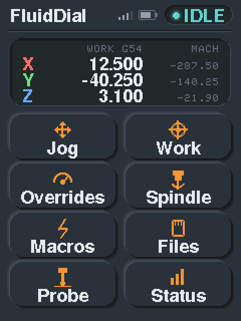
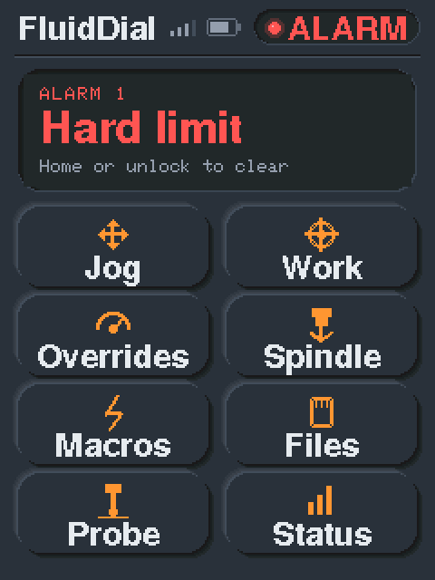
</p>

**Colours** (RGB565 is the value the panel shows):

| Use | Hex | | Use | Hex |
|---|---|---|---|---|
| Background | `#2C3038` | | Focus (orange) | `#FF9630` |
| Readout interior | `#25282F` | | Idle | `#60D0C8` |
| Text | `#E4E8EE` | | Run | `#5CDC80` |
| Secondary text | `#969EAC` | | Hold / Door | `#FFBE40` |
| Captions | `#646C7A` | | Alarm | `#FF5454` |
| Axis X / Y / Z | `#FF7068` / `#70E080` / `#68A8FF` | | Jog / Home | `#6EA8FF` / `#B08CFF` |

Screens can be tried in a browser without hardware — see [Simulator](#simulator).

---

## 🖥️ Screens & Features

### Main Menu
Eight tiles: **Jog, Work, Overrides, Spindle, Macros, Files, Probe, Status**. The card at the top shows the work and machine position (DRO). When something matters more it shows that instead: **Connecting… / Syncing…** while the link comes up, the alarm in plain words (e.g. "Hard limit") with a reminder to home or unlock, or an ESP-NOW problem (radio down, not paired, reconnecting to *machine*), labelled ESP-NOW so a link fault never looks like a machine alarm.

### Status

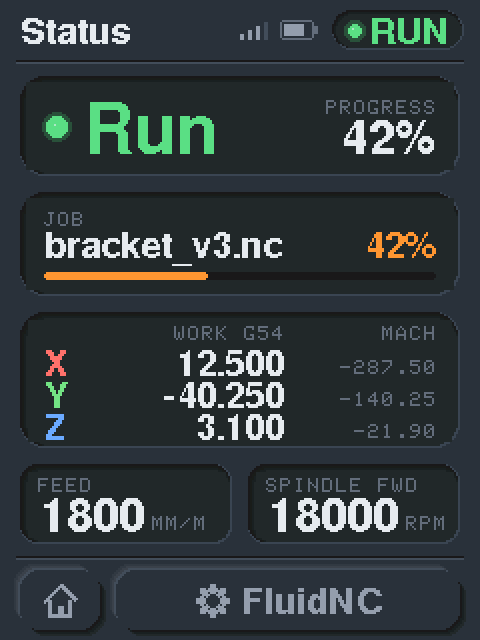

* **State card** — the machine state in large coloured type with its LED; job progress (%) on the right while a job runs. Long words such as "Connecting" drop a size rather than being cut short.
* **Job card** — the running file with a progress bar, or **Ready — Press green** with the file name after Load on the Files screen, or "No job running".
* **DRO** — work position (large) and machine position (small) for every axis the controller reports; 4–6 axis machines get two columns of work positions.
* **Feed** and **Spindle** (with direction) readouts.
* Bottom bar: Home | FluidNC.

<br clear="right">

### Jog

<p>
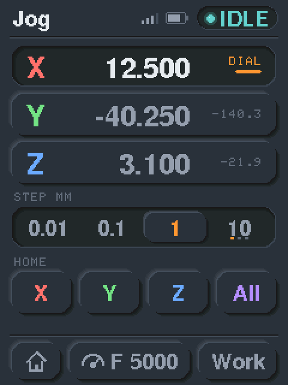
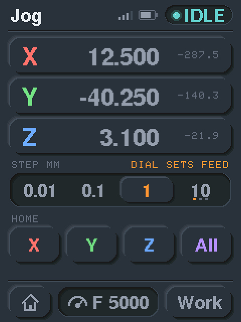
</p>

* **One row per axis** — tap a row to give that axis the dial. The selected row is pressed in and marked **DIAL**; the large number is the **work position**, the small grey one the machine position. While homing, the axis being homed shows **HOMING**.
* **Handwheel stop** — a single deliberate detent completes its full move, but during a **continuous spin** the axis stops the moment you stop turning (the pendant sends a real-time jog-cancel), so it doesn't coast through queued moves — like a full-size MPG.
* **Step** — 0.01 / 0.1 / 1 mm plus a **coarse slot** holding 10 / 50 / 100 mm (imperial: .001 / .010 / .100 in, then .5 / 2.0 / 4.0 in). Three dots under the coarse slot show which value it holds.
  * **First tap** selects the coarse step and you keep jogging. A **second tap** hands the dial to choosing 10 / 50 / 100 (orange ring, "DIAL PICKS STEP"). A **third tap**, or tapping an axis, hands the dial back to jogging on the axis you were on.
  * The selected step and the coarse value are saved and restored on reboot.
* Units follow the controller (G20/G21). The A axis is rotary, so its steps are labelled in degrees.
* **Home** — one button per axis in its axis colour, plus **All** on 3-axis machines.
* **Feed** — the bottom bar shows the jog feed (e.g. **F 5000**). Tap it and the dial sets the feed: 500 mm/min (20 ipm) per detent, from 1000 mm/min up to the controller's X maximum rate (`$110`). Tap it again to go back to jogging. The number shown is always the feed that is sent, and it can be set before the controller is connected.
* Velocity scaling — turning the dial faster proportionally increases the jog feed rate up to 8× the base speed, giving a natural acceleration feel.
* In alarm the step row says **ALARM: UNLOCK TO JOG**.
* **Soft-limit clamp** — once the machine is homed, the pendant clamps every jog so an axis's **absolute machine position can't leave its travel envelope**, preventing a fast or repeated jog from driving into a hard stop. The per-axis envelope is read from the controller's per-axis travel (`$130–$132`) and homing-direction mask (`$23`), so machines that home in different directions per axis work correctly. This engages only for homed X/Y/Z axes; it does not replace controller soft limits.
  * **Recommended:** also enable FluidNC's own soft limits as the authoritative backstop — set `$20=1` (soft limits) with `$22=1` (homing) in your FluidNC config. With `$20=1`, FluidNC itself rejects any over-travel move regardless of source. FluidNC ships with `$20=0` (off) by default.
* Bottom bar: Home | Feed | Work.

### Work Area

<p>
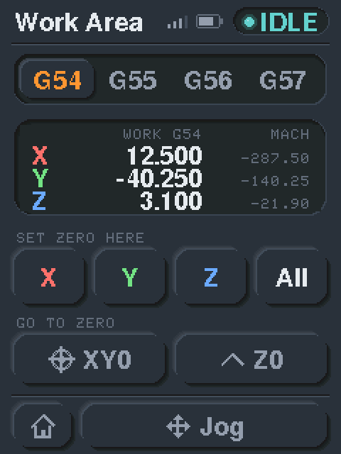
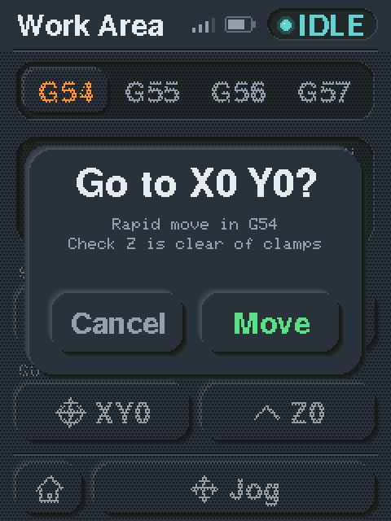
</p>

* **G54 / G55 / G56 / G57** — selecting one also makes it active on the controller.
* **DRO** — work and machine position.
* **Set zero here** — X, Y, Z (each axis the machine has) or **All**, in the selected coordinate system (`G10 L20 P<n>`).
* **Go to zero** *(new)* — **XY0** rapids to X0 Y0 and **Z0** lowers Z to the work surface, in the active coordinate system. Both ask first, with a reminder to check Z is clear of clamps.
* Bottom bar: Home | Jog.

### Overrides *(was Feeds & Speeds)*

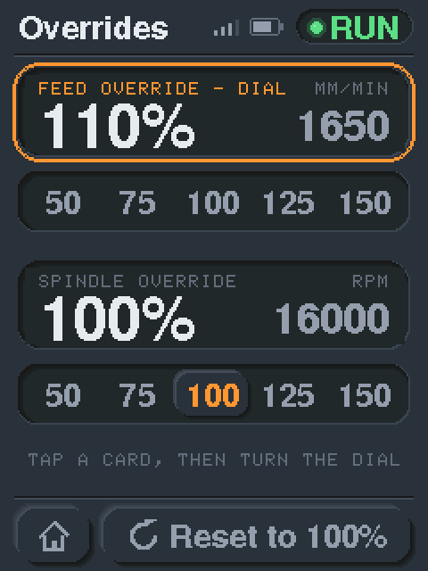

* A **feed** card and a **spindle** card, each with the override % and the actual feed or RPM.
* **Tap a card, then turn the dial** — 10% per detent; the card gets an orange ring. Tap it again to release the dial.
* Presets **50 / 75 / 100 / 125 / 150%** under each card; the preset matching the current value is highlighted. **Reset to 100%** in the bottom bar.
* Overrides ramp to the target with **paced coarse+fine steps** anchored off the current value (one realtime byte every ~60 ms) rather than a burst — gentle on a Modbus VFD and safe to use during a running job. The card shows the target straight away while the ramp catches up.

<br clear="right">

### Spindle

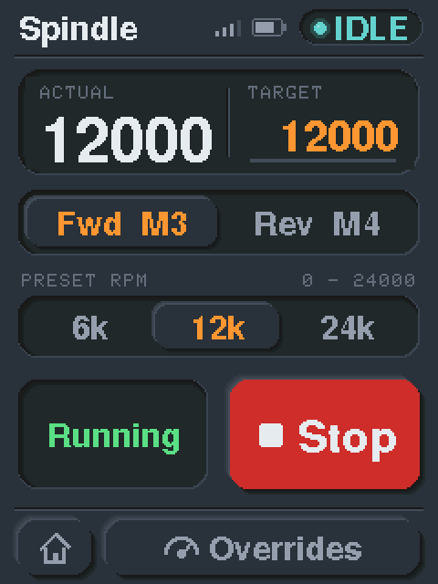

* **RPM card** — actual RPM on the left, **target** RPM on the right. Tap the card to set the target with the dial: 100 RPM steps for spindles up to 10 000 RPM, 1 000 RPM above that, clamped to the controller's range.
* **Fwd M3 / Rev M4**.
* **Presets** — a quarter, half and all of the spindle's maximum (`$30`), shown short (6k / 12k / 24k), with the controller's min–max range (`$30` / `$31`) above them.
* **Start** (green) and **Stop** (red) send M3/M4 with the target RPM, or M5. While the spindle runs, Start stays pressed in and reads **Running**; it pops back out if the spindle is stopped any other way.
* Bottom bar: Home | Overrides.

<br clear="right">

### Files *(was SD Card)*

<p>
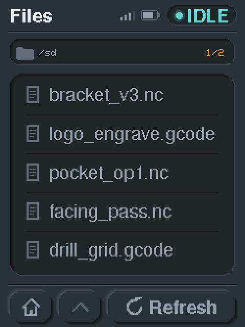
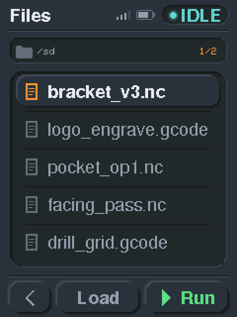
</p>

Browse and run G-code files live from the controller's SD card.
* The strip at the top shows the folder you're in and the page (**1/2**, with a trailing `+` if the folder has more than 100 entries). **Turn the dial** or **tap the page number** to page through the list, five rows at a time.
* **Folders** have a folder icon and a chevron; tap to open. **Up a folder** at the top of a subfolder walks back up. Only the folder you're in is loaded.
* **Tap a file** to select it; the bottom bar changes to **Back | Load | Run**. Tap it again to deselect. **Load** queues it and goes to Status, where the green button starts it; **Run** starts it straight away. The full path is sent, so files in subfolders run correctly.
* **Refresh** re-lists the folder you're in.

### Macros

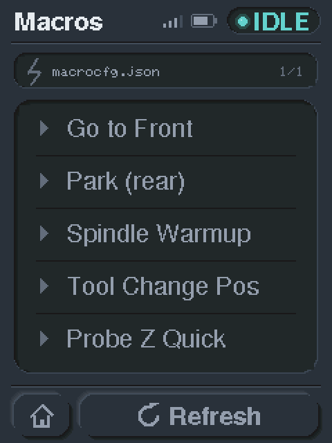

The same list style as Files, holding up to 100 macros. Reads macros directly from the FluidNC controller by JSON streaming over the active transport. Macros must be defined in **`macrocfg.json`** (WebUI v2 format); the WebUI v3 `preferences.json` format is **no longer supported** as of v2.2.0. The list loads on first entry and is cached — subsequent visits are instant; **Refresh** fetches a fresh copy. Tap a macro, then **Run macro**; it sends the command and goes to Status.

<br clear="right">

### FluidNC

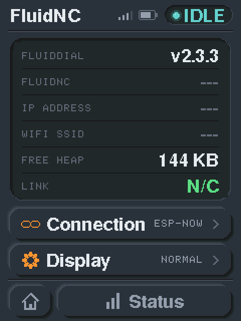

* Pendant firmware version, controller firmware version, IP address, network, free heap and link status. Values the controller hasn't reported yet show `---`.
* The network row follows what the controller reports: a WiFi SSID on a wireless controller, or **Wired Ethernet** (amber **Ethernet, no link** if the cable is out) on a wired one such as the Greyhound. Works over UART and ESP-NOW, on current FluidNC releases as well as newer ones: where `$I` reports no Ethernet (anything up to v4.1.1), the pendant reads `$network/type` and `$Ethernet/Status` instead.
* **Connection** opens the Connection screen.
* **Display** — tap it, or turn the dial, to turn the display 180°; saved across restarts.
* Reach it from Status (bottom bar). Bottom bar: Home | Status.

<br clear="right">

### Probing

<p>
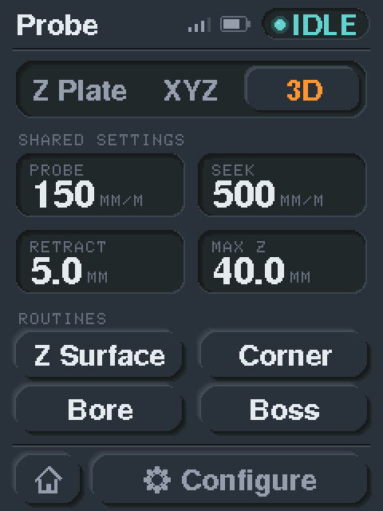
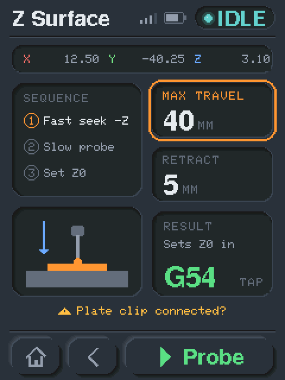
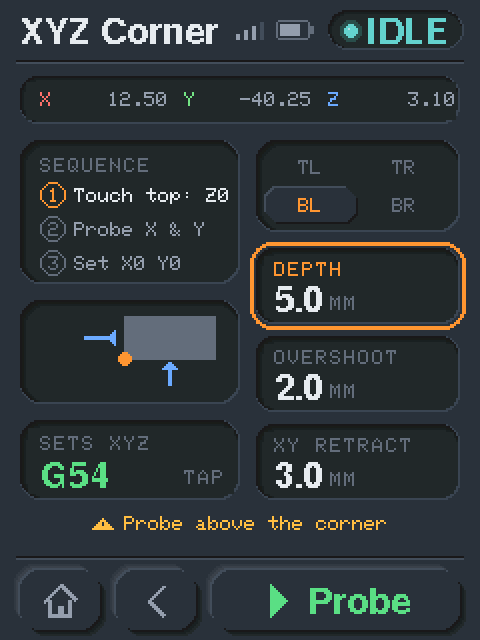
</p>
<p>
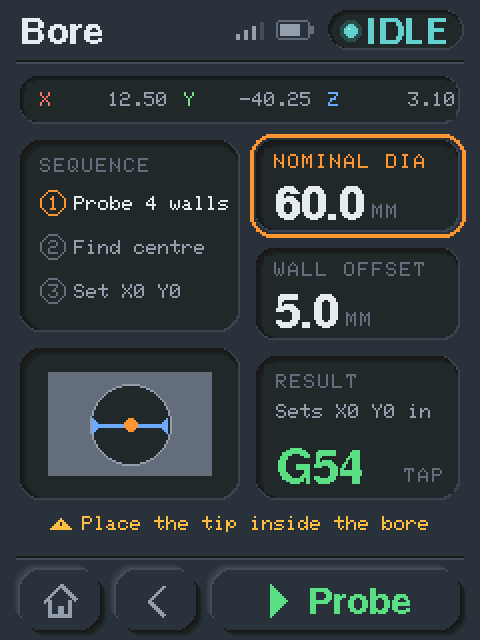
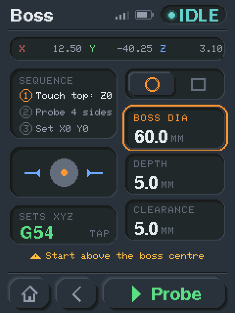
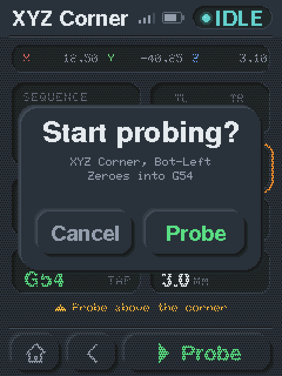
</p>
<p>
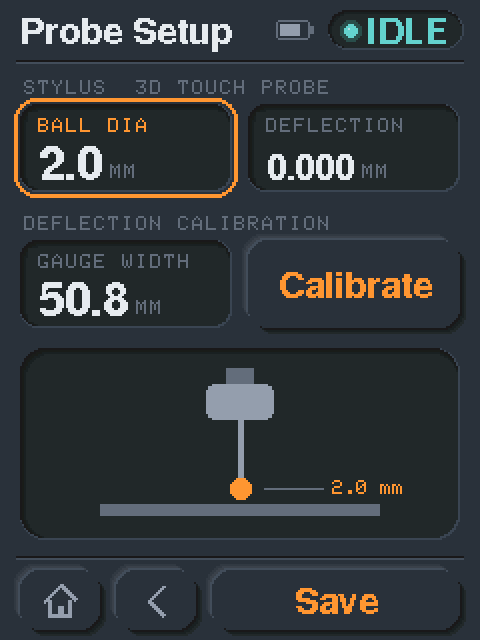
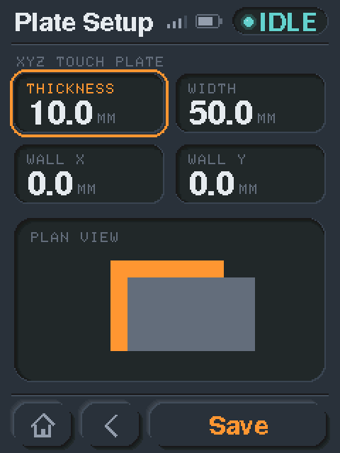
</p>

* The **Probe** hub picks the probe type — **Z Plate**, **XYZ** touch plate or **3D** touch probe — and the routines on offer change to match. **Shared settings** (probe rate, seek rate, retract, max Z travel, all in mm) apply to every routine: tap one, then turn the dial. The default seek rate is 500 mm/min.
* Routines:
  * **Z Surface** — probes Z and zeroes it (all probe types).
  * **XYZ Corner** — finds a workpiece corner and sets X0/Y0/Z0 (XYZ plate and 3D probe). Pick the corner on the **2×2 picker** (TL TR / BL BR, laid out like the corners themselves); the diagram follows.
  * **Bore** — finds the centre of an inside circle and sets X0/Y0 (place the tip inside at any depth — there's no Z motion; set Z separately with Z Surface) (3D probe).
  * **Boss** — finds the centre of a raised feature; touches the flat top for Z0 and sets X0/Y0/Z0 (3D probe). Choose **round** (one diameter) or **rectangular** (X size / Y size) with the shape picker.
* Every routine screen shows the live work position, the **sequence** it will run, a **diagram** of the move, its settings, and a **result card** naming what it sets and in which coordinate system — **tap the card to cycle G54–G57**. **Probe** opens a confirmation naming the routine and the coordinate system before anything moves.
* Probe G-code is **generated on the pendant** (`G38.2` straight-probe moves) — no probe macro files need to live on the controller. Every wall/surface is reached with a **crash-safe two-pass move** (a fast seek then a slow re-probe), so a wrong nominal size can't drive the tip into a wall; the trigger offset is computed automatically from the configured plate thickness or 3D-probe ball radius, so a routine zeroes correctly whichever probe you use. Each axis also **returns to its exact `G38.2` trigger point** (`#5061`/`#5062`/`#5063`) before its zero is written, so the machine's deceleration overshoot — which leaves it resting slightly past where the probe actually fired — never enters the work offset; FluidNC's `hard_stop` is **not** required for accurate zeros.
* **Configure** (hub bottom bar) opens the setup for the selected type. For the 3D probe: ball diameter plus an optional deflection correction (added to the ball radius; default 0), and an on-pendant **Calibrate** routine that measures it against a known gauge (e.g. the 2″ face of a 1-2-3 block) — it asks before moving, shows progress, then offers to apply the measured value. For a touch plate: thickness, plus width and X/Y wall offsets for the XYZ plate. **Save** stores the settings; **Back** leaves without saving.
* **For more info** — see the [Probing Guide](Probing.md) for a per-screen breakdown of every probing screen, what each option does, and how each routine moves the machine.

---

## 🔋 Battery Status (capacitive CYD only)

On capacitive-screen CYDs a small battery icon appears in the header of every screen, beside the state chip, when a LiPo battery is connected to the CYD's 3.3 V rail (via GPIO 39 voltage divider) and the pendant is running wireless:

* **Fill colour** — grey above 50 %, amber 20–50 %, red below 20 %
* **Charging indicator** — an amber lightning bolt appears on the battery icon while charging. Charging is inferred from the battery-voltage trend (rising/held-high ⇒ on charger), so it reacts within ~30 s of plugging in. A short post-boot settling window suppresses it for the first couple of minutes after power-up, so the normal boot-load voltage recovery isn't mistaken for charging
* **Update rate** — battery level refreshes every 5 seconds; charging status every 3 seconds (cheap ADC read)
* **Screen sleep** — to save power on battery, the display backlight switches off after **15 minutes** with the CNC Idle (or stuck "Connecting", eg your CNC is powered down and pendant is charging); **a touch anywhere wakes it** back to the screen you left, without sending any command to the controller. This is backlight-off only — the pendant stays connected and running. Wired (UART) pendants don't sleep
* The icon is hidden on resistive CYDs, on a wired (UART) pendant, or when no battery hardware is detected

No wiring changes are needed on CYD boards that already have the battery circuit populated. Battery monitoring is built into the shipping firmware — no opt-in required.

> ⚠️ **"Off" still drains the battery.** Holding the red button powers the pendant *off* by putting the ESP32 into deep sleep, but the CYD's voltage regulator and other on-board parts keep drawing a few milliamps from the battery — there is no hardware switch that fully isolates the cell. A charged LiPo will therefore slowly self-drain over a day or two even while "off", and can end up flat. **If you run on battery, put the pendant on USB charge after use** (or unplug the battery) so it's ready next time.

---

## 📡 ESP-NOW Transport

> **v2.2.0 removed the WiFi transport.** It proved unreliable in practice — the CYD's small antenna, plus FluidNC serving its WebUI and the pendant WebSocket on the same port 80. It is replaced by **ESP-NOW**, a direct encrypted peer-to-peer radio link with no access point, DHCP or TCP in the path. **If you need WiFi, stay on [v2.1.11](https://github.com/dJOS1475/FluidDial-CYD/releases/tag/v2.1.11).**

<p>
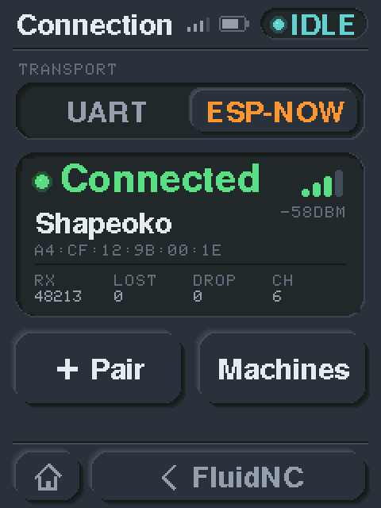
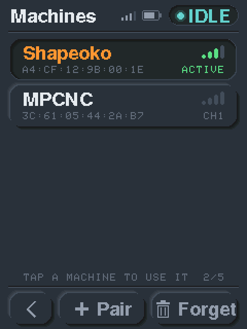
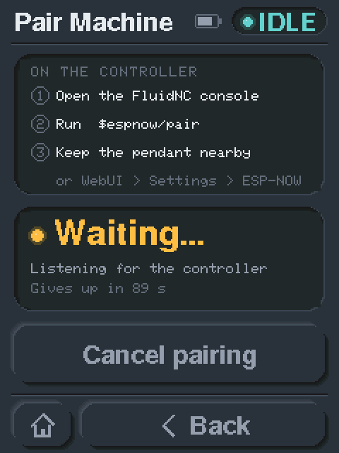
</p>

The pendant offers two transports, chosen on the **Connection** screen:

| Transport | Use for |
|---|---|
| **UART** (default) | wired pendants — unchanged, still the most reliable option |
| **ESP-NOW** | battery / untethered pendants |

UART is the default on a fresh flash, so a new pendant never starts a radio unprompted. The choice is stored in NVS and survives firmware updates. Changing it reboots the pendant after a 5-second countdown — the transport is only selected at boot. **Tapping back to the transport that's running cancels the reboot.**

### Requirements

**FluidNC v4.0.4 or newer**, which ships ESP-NOW in the stock release — no custom controller build is needed. Older controllers will not respond to pairing.

### Pairing

The pairing action happens **on the controller**, not the pendant:

1. On the pendant: **Main Menu → Status → FluidNC → Connection**, choose **ESP-NOW**. The pendant counts down 5 seconds and reboots itself to apply the change.
2. On the Connection screen tap **Pair** (the link card says "Not paired" until a machine is added).
3. On the controller, run **`$espnow/pair`** in a FluidNC console — or use **WebUI → Settings → ESP-NOW → Pair Pendant**. The pairing screen ticks off the steps and gives up after 90 seconds if nothing answers, with Retry / Cancel.
4. The two exchange P-256 ECDH keys and derive a unique key for that pair. The screen shows **Paired** with the machine name, MAC and channel.
5. Tap **Use this machine**.

### Multiple machines

Up to **5 controllers** can be paired. The **Machines** screen (Connection → Machines) lists them; the active one is pressed in and shows its signal and **Active** (or **Offline**). Tap a row to switch machines, or **Forget** to remove one (it asks first). FluidNC keeps its own list of paired pendants, manageable from its WebUI or with `$espnow/list` and `$espnow/unpair`.

### Feature parity with UART

ESP-NOW is a byte-stream transport exactly like UART, so **everything behaves identically on both**: jogging and the handwheel dial-stop, homing, all probing routines, feed/spindle overrides, the DRO, SD job streaming, and macros. There is no ESP-NOW-specific behaviour to learn.

Macros use the `$File/SendJSON` chain on both transports and must live in **`macrocfg.json`** — see Macros above. (v2.1.x fetched them over HTTP in WiFi mode — that was a workaround for the WebSocket truncating large files on the shared port 80, and it left with WiFi.)

### Signal strength and status

On a wireless pendant four signal bars sit in the header of every screen, beside the battery and the state chip. The **Connection** screen shows live link state, machine name, peer MAC, signal and RSSI in dBm, the channel, and receive counters (**RX** bytes; **Lost** and **Drop**, which both read 0 on a healthy link).

### Upgrading from v2.1.x

A pendant that had WiFi selected comes up on **UART** after the upgrade — any stored transport the firmware no longer recognises falls back to the wired path, rather than booting into a dead link with no UI to escape it. Select ESP-NOW on the Connection screen and pair when you're ready.

---

Wiki pages for more information: CYD Dial Pendant (http://wiki.fluidnc.com/en/hardware/official/CYD_Dial_Pendant).

### Building from source

The only supported build target is **`cyd_new_ui_combined`** — a single binary that runs on every supported CYD variant (resistive XPT2046, capacitive CST816S, with or without the IP5306 battery PMIC). It is the binary published via the web installer and on the [Releases page](https://github.com/dJOS1475/FluidDial-CYD/releases).

```
pio run -e cyd_new_ui_combined
pio run -e cyd_new_ui_combined -t upload
pio run -e cyd_new_ui_combined -t uploadfs   # the boot logo and images in data/
```

The boot logo lives on the pendant's filesystem (LittleFS), so after changing anything in `data/` also run **Upload Filesystem Image** (`-t uploadfs`). It replaces the whole filesystem with the contents of `data/`.

Other PlatformIO environments in `platformio.ini` (`cyd_new_ui`, `cyd_base`, `cyd_resistive`, `cyd_nodebug`, `cyd_buttons`, `cyddial`, `m5dial`, `windows`) are retained as historical / development references and are **not** maintained for end-user use. Build them at your own risk.

### Simulator

`simulator/` runs every screen in a browser at the panel's real resolution and colours, with touch, the jog dial and live machine state. It is the design spec for the firmware screens.

```
python simulator/dev_server.py 8777      # then open http://localhost:8777
```

It reloads on every file change and keeps the current screen. The bench panel on the right drives machine state (status, positions, link, axes, units, alarms). All the pictures on this page were taken from it.

FluidNC Discord Topic: https://discord.com/channels/780079161460916227/1453176703009423514

## 💛 Project Supporters

A huge thank you to the following people who have supported this project:

| Supporter | Platform |
|---|---|
| simrim1 | Discord |
| Janusz  | Discord |
| karlpe  | GitHub  |

---

[](https://paypal.me/derekjosborn)

FluidDial-CYD Firmware in Action connected to my CNC Machine Simulator:

FluidDial-CYD v1.0.0:
[](https://youtu.be/d5PogiUiiaw)

FluidDial-CYD v2.1.7:
[](https://youtu.be/rT5MI35Bp68)
